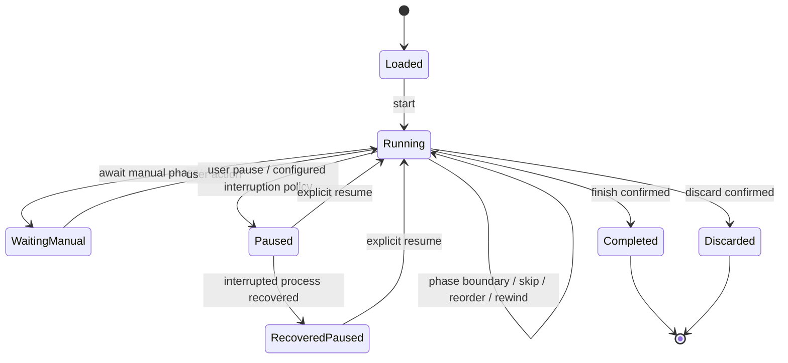

# Workout execution semantics (proposed normative model)

The following model is a starting concrete interpretation of Decisions 3–16, 26–29, 40, 47, 52. M0 must test it against a realistic composite plan and propose ADR changes if constraints or ambiguities surface. The initial JSON Schemas are **illustrative contracts** and may be refined without weakening behavior.

## Domain objects

1. `TrainingTemplate`: stable `templateId`, `revisionId`, multilingual labels, ordered sections, exercise occurrences and blocks. A template is not a performed session.
2. `Section`: optional named grouping (warm-up, strength, mobility, stretching, etc.).
3. `Block`: simple or composite, with an arbitrary number of exercise occurrences, each with one or more sets. A single exercise family may occur multiple times in one template.
4. `ExerciseOccurrence`: stable per-template and per-block ID, reference to exercise family/variation, optional occurrence-specific coaching instructions.
5. `Set`: stable ID, repetition count or timed/manual tasks; variation and resistance can differ per set. Resistance is per-set, not per-repetition.
6. `ExecutionOrder`: explicit serialized steps selecting `{setId, repetitionIndex}` or a timed/manual rest. Auto alternation patterns compile to this representation; users may inspect and change sequence.
7. `Phase`: each repetition/hold has timed prepare, hold, release or rest segments; manual phases use an elapsed stopwatch and wait for input. Optional left/right labeling.
8. `CompiledExecutionPlan`: immutable ordered atomic transitions with stable `stepId`, `phaseId`, `durationMs`, `policy`, and provenance IDs.
9. `ActualSession`: immutable source template/plan snapshot, chronological event log plus derived session actuals, ratings and journals.

## Mandatory stable IDs

Track templateId, revisionId, sectionId, blockId, occurrenceId, exerciseFamilyId, variationId, setId, execution step/eventId and sessionId; rep index is ordered within a stable set. Keep explicit *occurrence identity*: two copies of the same exercise are NOT interchangeable for previous-performance lookup. The identity of a session/plan remains stable even if display order changes.

## Compiler rules

- Parse YAML using a safe parser; validate against versioned schema, reject unsafe tags, cyclic refs, dangling exercise/variation/set references, duplicate IDs, nonpositive durations/counts and invalid order positions.
- Compile to a deterministic list of atomic phases with expected cumulative timing. Intermediate event steps (manual/timed rests) are explicit. Empty optional sections are allowed, unsupported unreachable transitions are rejected.
- Capture plan checksum (canonical serialization), schema version, engine version and source template revision. Never compile from a mutable Drive file during an ongoing workout.
- Audio cues are *outputs* triggered by state changes and deadlines, never the authority controlling elapsed time. A delayed cue may be skipped/flagged, not stretch a timed phase.
- Back navigation must record correction/rewind events; it may change remaining execution position and derived actuals but must preserve original audit history. Do not fabricate completed reps after a skip.
- Each active manual rep can use an auto-start next stopwatch or explicit tap to start; elapsed durations recorded per repetition.
- Distinguish pause initiated by user, manual wait, configured rest, system interruption, suspended process, and actual workout end.

## State machine

Transitions are generated by `(state, inputEvent, injectedClock)`; commands are deterministic. Invariant checks reject double-completion, invalid phase, negative elapsed, edits to archived session snapshots and event-ID reuse. Scheduled vs actual runtime measures must not be collapsed.

## Time categories

Keep these as separate fields. Do not add them together into one "the" workout clock.

- **Scheduled time.** Compiled phase boundaries from the Training Template. The synthetic golden timeline is 50,000 ms only when nothing is paused, skipped, or repeated.
- **Observed execution time.** Elapsed time measured from a monotonic clock while this process is alive and the session is running. Derive the countdown from monotonic differences, not from summing one-second UI ticks.
- **Pause duration.** User pause and configured interruption pause. Record the interval. It is not exercise time, and it does not advance scheduled phase deadlines.
- **Unobserved gap.** Process death, reboot, or a monotonic-clock discontinuity. Do not assign that gap to exercise, rest, or completed repetitions. Recovery loads the last durable checkpoint, marks the gap as uncertain, and waits for an explicit resume, phase restart, or discard. Never silently fabricate the missing history.

## M0 event counter snapshots

For the M0 reducer, each event records the four elapsed counters at its logical
transition, in milliseconds; these are not UTC timestamps or audio-delivery times.
This makes Decisions #47/#52 and GA-EXE-003/GA-WEB-003 testable independently of
the UI tick frequency:

- `scheduledElapsedMs` is the plan position at the transition. A boundary event
  uses the exact compiled boundary, even if one advance crosses several phases.
- `observedRunMs` is cumulative running time consumed by the reducer, including
  timed rests. At a crossed boundary it equals the counter before the advance
  plus the distance from that advance's starting plan position to the boundary.
  It is not reconstructed from absolute scheduled time: skip/rewind can make the
  two counters differ. Time beyond the terminal plan boundary is not consumed.
- `pauseMs` increases only when an advance is supplied while user-paused.
  It never advances the plan or observed running time.
- `unobservedGapMs` increases only through an explicit `NoteUnobserved` input.
  That event captures the newly increased gap counter, leaves other counters and
  completed phases unchanged, and enters recovered-paused. Advances in that state
  are ignored until explicit resume; the gap is neither running nor pause time.

At a natural boundary, `phaseCompleted` precedes the next `phaseStarted`; both
capture identical counters. The final boundary emits no next-phase start.
Pause/resume events capture the current counters. Navigation events capture the
destination plan position with unchanged running/pause/gap counters; the paired
phase-start event has the same counters. Skipping never emits completion for the
skipped phase, and rewind preserves prior events while revising derived completion.

Partitioning a nonnegative advance into smaller advances, without an intervening
action, must leave the entire event sequence and final counters unchanged.
`examples/expected/composite-pyramid.events.json` supplies independent full-event
expectations and shared partition patterns for both engines: uninterrupted
overshoot, pause/resume, a running gap that waits for resume, recovery from a
paused gap, skip/rewind followed by recovery, a skip without rewind, and replay of
an already completed hold with intermediate completion-state checkpoints. It
supplements the existing planned timeline fixture. These tests exercise injected time, not platform gap
detection, durable recovery, or UI clock-adapter accounting.

## Clock model and Android restrictions

Use a monotonic elapsed clock while execution is alive; keep an anchor, pause offsets, scheduled phase deadlines and separately measured actual event timestamps. Avoid per-second timer accumulation; derive UI countdown from monotonic differences. After app process termination, boot, or device power loss the original monotonic anchor may no longer be comparable. **Never invent that elapsed exercise happened while unobserved**; recover from durable checkpoint, show time uncertainty and obtain explicit user confirmation before resuming. Evaluate foreground-service type/permissions and notification handling on Android 12+ according to platform policies. WorkManager is suitable for *deferred sync*, not a guaranteed subsecond live exercise loop. No blanket exact-alarm permission requirement unless justified and approved.

## Interruption policy

User-selectable policies for calls, temporary audio focus, Bluetooth output loss and others: continue, automatic pause, or user confirmation as configured. Auto-paused work never silently resumes mid-repetition. Audio delivery failures produce visible warnings and local telemetry with no personal notes in external logs.

## Previous performance

Lookup key: `(templateId, blockOccurrenceId, exerciseOccurrenceId, variationId, setId)` and latest completed applicable session. No cross-template fallback, no name-only association and no conflation of repeated exercise occurrences. Show source session and actual vs planned numbers. Per-set resistance configurations remain categorical unless independently quantified.

## Synthetic conformance fixture

`examples/templates/composite-pyramid.yaml` defines two exercise occurrences, three sets, four interleaved repetitions, and a 10-second rest. `examples/expected/composite-pyramid.timeline.json` specifies the exact 50,000ms phase sequence. `tools/validate_starter.py` checks IDs, coverage, sums, and expected timings (not a full engine). Extend with deterministic navigation, pause, process recovery, multiple variations, manual stopwatches, random state-machine tests and Android/web trace parity.

## Session record semantics

- Every action (`sessionStarted`, `phaseStarted`, `manualRepCompleted`, `pause`, `resume`, `skip`, `rewind`, `blockInserted`, `setActualUpdated`, `sessionCompleted`) is immutable, uniquely identified and ordered.
- Session derived materializations can be rebuilt from the event log + versioned plan snapshot; edits append new events/revisions, never silently erase provenance.
- Capture separate overall RPE, **subjective personal rating**, **subjective journal summary**, optional notes, block-level deviations and active/rest/total times.
- Session export to Google Sheets starts after successful canonical sync and is retryable/idempotent.

## Optional organizational resolution before compilation (Decisions #79–#97)

Before compiling a Training Template, resolve an optional `TrainingProgram → membership → immutable TrainingTemplate revision` path. Apply only permitted, ID-targeted Program overrides and limited existing-set usage. Validate the effective plan after expansion. This scope is NOT part of the core timed state machine and MUST not alter strict clock or per-repetition semantics. Session start snapshots include source Template revision, effective plan, optional organization context and revision/override provenance. If latest+overrides cannot resolve, prefer last validated configuration and show pending upgrade; never silently drop invalid overrides. Generated step instances from repeated set patterns must have deterministic distinct execution-instance IDs linked to original source IDs. A separate proposal, approved after completion, can publish selected actual deviations as a new Program override revision or a new Template revision; never edit the already executed plan.

Previous performance remains keyed by `(templateId, blockOccurrenceId, exerciseOccurrenceId, variationId, setId)` with same-Program (any Season) preference; if absent, transparent same-Template fallback to a different/no Program, always exposing provenance. No fallback across Template IDs. See `docs/architecture/seasons-programs-and-promotion.md`.
