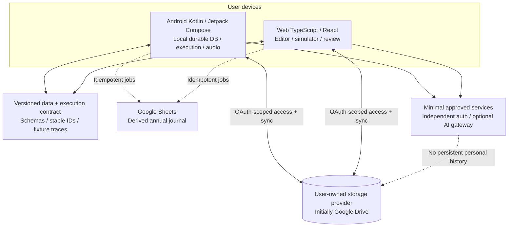
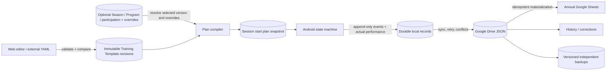

# Approved architecture overview, with provisional implementation choices

The *principles* are approved. Specific providers and libraries are deliberately **not** approved or provisioned. Avoid assuming `KMP`, specific OAuth host, Firebase, cloud functions, Google Cloud project, or paid vendor until evaluated and separately approved.

## Canonical organization (Decisions #79–#97)

`Training Season (optional)` ⇄ `SeasonParticipation` ⇄ `Training Program (optional)` → `ProgramTemplateMembership` → `Training Template (versioned)` → `optional Section` → `Block` → `Set` → `Repetition/Action`. A **Workout Session** is an actual Android execution with immutable start-time Template revision, effective plan, and optional captured Season/Program context. A Season may have many participating Programs, and a Program may participate in many Seasons; at most ONE Season is globally Active. Programs may be active standalone. See [complete domain architecture](seasons-programs-and-promotion.md).

## Context diagram



The dashed backend-to-Drive relationship represents **only future, approved, narrowly scoped operations**; server-side access to personal history is not an assumed feature. The background job/sync feasibility must be verified for each platform.

## Component boundaries

- `apps/android`: native presentation and Android platform adapters (clock, foreground notification, TTS, audio focus, local persistence, Google OAuth; never interpret mutable YAML during an active session).
- `apps/web`: web-based editor, structural validator, deterministic dry-run, import review, history, corrections, opt-in analytics. No actual workout execution logging.
- `packages/contracts`: human-readable canonical schemas and version identifiers independent of storage, UI and platform.
- `packages/engine`: **logical** platform-neutral compiler from valid template to immutable execution plan and pure clock-injected state machine. M0 validates KMP Kotlin/JS vs two conformant Kotlin/TS engines; do not force code reuse.
- `packages/cloud-adapters`: logical storage interfaces: data listing, read, compare-and-swap/update, change detection, permissions, versioned backup, user-owned account link and sync. Google Drive initial implementation; adapters not yet coded.
- Minimal future services: identity and optional AI gateway; never store copies of personal workout history. Any new service requires approval and cost inventory entry.

## Persistence



## Architectural invariants

1. Template, Season, and Program changes do not mutate active or completed Workout Sessions; session-start plan version is immutable; session edits represented by ordered events/revisions.
2. Rep-level alternation is explicit after compilation. Deterministic clocks and replayable input actions; required cross-platform trace equivalence.
3. Planned scheduling, actual measured elapsed durations, audio delivery, and subjective values are distinct record types.
4. One active execution owner for a workout; records from divergent offline branches must survive conflicts. Multi-device transfers require successful sync confirmation and a protocol with fencing/version tokens.
5. Device local writes precede network writes; journal materialization must be idempotent and track provenance. Sheets is a projection, not the source of truth.
6. Encryption at rest/in transit via appropriate platform facilities now; optional E2EE future. No universal claim of strict end-to-end privacy while Sheets is shareable and AI providers process selected content.
7. Original imported documents and personal data outside Git; application data accessible only in user-approved account/folder scopes. Backups outside the primary app folder.
8. Cross-provider portable data model; one storage adapter does not dictate contracts.

## Additional domain invariants

- Template belongs to nobody by default; Program membership is an independently versioned reference and Program↔Season participation is an explicit association.
- Only one Season Active; independent standalone Programs may remain Active. Season completion requires explicit per-Program review, without implicit global Program completion.
- Program overrides are limited and verified against immutable Template revision; incompatible `latest` update retains last validated effective plan until reviewed.
- Historical Workout Sessions snapshot Template revision, effective overrides, optional Season/Program labels and structural revisions, independently of later reorganization.
- End-of-workout selectively promoted changes require explicit user approval for a chosen scope and create NEW revisions, not retroactive edits.

## Illustrative repository layout

```text
apps/android/             Native Kotlin / Compose app (M0)
apps/web/                 TypeScript / React app (M0)
packages/contracts/       JSON Schemas, generated contracts (M0)
packages/engine/          Shared engine spike or conformance specs (M0)
packages/cloud-adapters/  Provider-neutral interfaces / mock / Drive (M0–M1)
schemas/                  Canonical format drafts
examples/                 Sanitized fixtures and expected events
scripts/ or tools/        Mac bootstrap, lint, fixture checks
docs/                     Product, architecture, ADRs, milestones, runbooks
.github/                  CI, issue/PR templates
.cursor/                  Cursor rules pointing to AGENTS.md
```

## Working technology recommendations, **not commitments**

- Android: Kotlin, Jetpack Compose, local SQL persistence (e.g. Room; evaluate), minSdk 31 (Android 12); foreground execution design validated against current Android rules.
- Web: TypeScript and React; hosting choice after provider approval.
- Backend: none if possible in M0; TypeScript/Node as an acceptable option if identity, AI or coordination truly require service processes.
- Engine: KMP/Kotlin/JS feasibility experiment (interoperability with existing React app) vs independent Kotlin + TypeScript conformant implementation.
- Schemas: JSON Schema for YAML templates and JSON execution/session records; typed model/codegen strategy must be evaluated.
- Storage: Google Drive user-owned (scoped access, picker/created files) and Google Sheets annual derived reports.
- AI: optional BYOK and explicit consent; API key storage on browsers is a security decision to resolve, not an assumption.

## Why not a feature-complete generated application immediately?

Complex multi-exercise alternation, timed phases, offline operations and Sheets regeneration form a high-risk stateful system. M0 must provide verified executable traces and physical-device observations first; subsequent vertical slices preserve realistic functionality, not throwaway mock UI.
