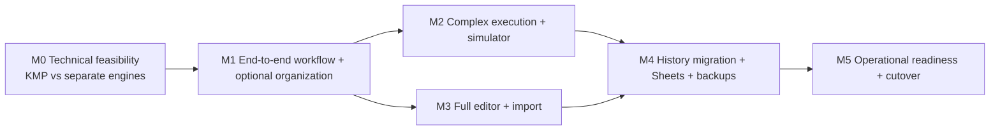

# Milestone sequence, approvals and dependencies

**Strategy:** high-risk M0 proof, then complete end-to-end vertical slices. Each milestone outputs frequent installable Android artifacts and browser preview/test instructions. Do not start M1 on an unreviewed architecture without recording unresolved gaps.

| Milestone | Core result | Approval gate |
|---|---|---|
| M0 | Kotlin Android prototype + browser dry-run, same composite timeline, virtual clock, engine ADR; basic Drive adapter shape | User evaluates Android device + web demonstration and engine architecture report. |
| M1 | Real selected Training Template ↔ Drive, Android Workout Session recording, cloud JSON, web review, interruption recovery; foundational Season/Program membership, context and independent direct execution | Real user phone and web smoke test, OAuth/provider approval, no cloud history loss. |
| M2 | Full execution semantics, interleaved pyramids, per-set bands, manual reps, audio interruption policies, Program-aware strict prev-performance matching, full simulator; limited Program overrides and effective-plan validation | All high-risk sequence fixtures pass Android/web conformance, physical audio and background tests. |
| M3 | Visual/YAML authoring, exercise families/media, optional BYOK AI-assisted PDF import; Season/Program create, clone, lifecycle, version policies, override editing, validation, comparisons and promotion UX | Real private PDF reviewed in user's environment only; manually reviewed import; no silent template changes. |
| M4 | Verified historical migration, annual Sheets with Season/Program headers, protected comments, Season/Program count/frequency reports, independent backups/restore, idempotent sync | Dry-run + sample restore + user-reviewed migration and no duplicate Sheets columns. |
| M5 | Beta account/auth, security/privacy, high-reliability long sessions, accessibility, cost controls, APK/Play beta pipeline, parallel cutover | User approves daily-use release after real workouts, Sheets fidelity, offline/recovery and battery tests. |

Several P0 cross-cutting requirements (authentication, schema safety, offline conflict handling, real web editor and advanced analytics foundations) must be completed before first release even if not the headline of one milestone; `requirements.md` and `release-acceptance.md` override roadmap shorthand.

**Per-milestone definition of done:** runnable increment, passing CI and conformance tests, changed requirements traced, updated docs+handoff, user-facing install/preview and explicit evidence. **User approval required** for architectural/security/destructive changes, milestone closure and production release. Routine within-milestone PRs may be merged under approved semi-autonomous workflow.

Automated emulator testing across supported Android versions is mandatory from M1 onward. M0 may defer that matrix during the engine spike. M0 still requires virtual-clock tests, the 50,000 ms composite trace, and a physical-phone smoke test. Scheduled time, observed execution time, pause duration, and unobserved gaps stay separate; unobserved time is never recorded as completed exercise.

### Domain extension and milestone boundaries (#79–#97)

M0 scope stays focused on execution-engine feasibility: fixtures remain runnable without any Season or Program. Add schema/reference validation without making organization a dependency for completing M0. M1 establishes optional references and session-start context snapshots early; incomplete organization UI is acceptable in M1 ONLY, not final daily-use release. M2 validates effective-plan resolution/limited set usage and prev-performance source selection. M3 completes web planning and Android organizational lifecycle/home, clone/version review, incompatible upgrade handling, and explicit post-session selective promotion. M4 adds journal headers and basic grouped metrics. M5 tests one-active-Season transitions, Program participation carry-over, standalone workflows, clones with cleared dates, historical invariance and incompatible override recovery. Automatic recurring scheduling/goal dashboards are post-MVP unless separately approved.
